<div align="center">

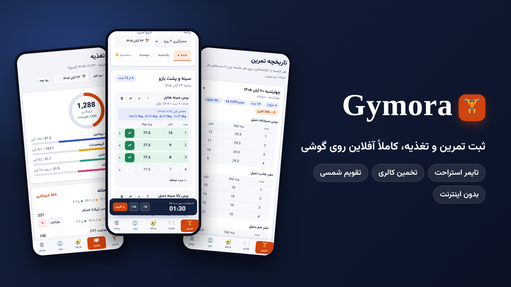

# Gymora

**Offline gym workout & nutrition tracker for Android — Persian (RTL) UI**
**اپ ثبت تمرین و تغذیه؛ کاملاً آفلاین، فارسی و راست‌چین**

React 19 · Vite · Capacitor 8 · IndexedDB · Jalali calendar

</div>

---

## English

Gymora is a single-user mobile app for logging gym workouts and daily nutrition. It runs **100% on the phone**: there is no server and no account. All data lives in the device's IndexedDB, and can be exported/imported as a JSON backup.

### Features
- **Workout logging** — pick a program & day, tick off each set; weights/reps pre-filled from the last session.
- **Rest timer** — configurable rest between sets and between exercises, with sound + vibration; −15 s / +15 s / skip.
- **Edit the workout on the fly** — add, swap, reorder or remove exercises, add/remove sets; unfinished workouts are restored after closing the app.
- **Rest-day aware** — on a rest day the app says so and lets you train anyway (free workout or borrow another day).
- **Calorie estimate** — per-workout energy estimate (MET method) based on sets, rest times and your body weight.
- **Workout history** — collapsible sessions with volume, duration, calories and per-set tables.
- **Nutrition** — food database (with units like tablespoon / piece / cup), meals, daily calories & macros ring, 7/14/30-day history chart.
- **Calorie & macro plan** — Mifflin-St Jeor + activity level + weight goal with target date.
- **Body weight log**, **Jalali (Persian) calendar picker**, kg/lb units, Gregorian/Jalali date toggle.
- **Backup / restore** to a JSON file via the Android share sheet.

### Screenshots

| | | |
|:--:|:--:|:--:|
| 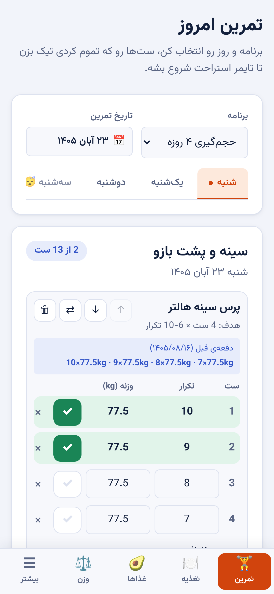<br>Workout logging | 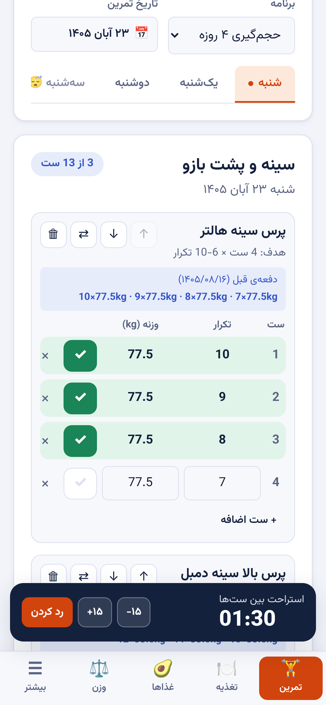<br>Rest timer | 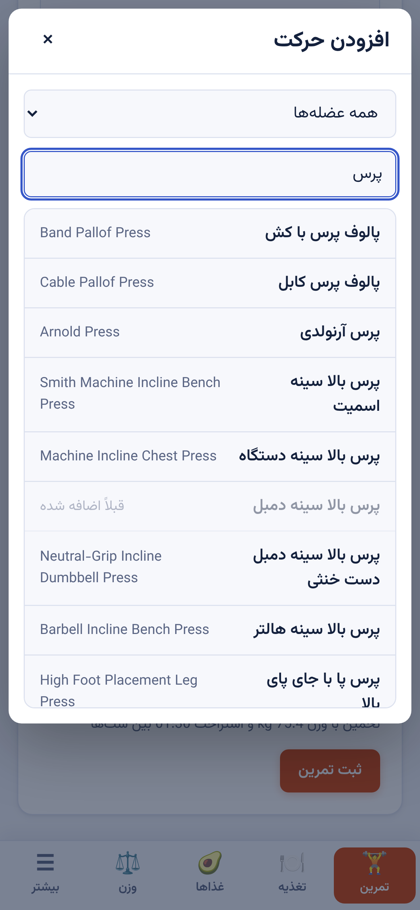<br>Add / swap exercises |
| 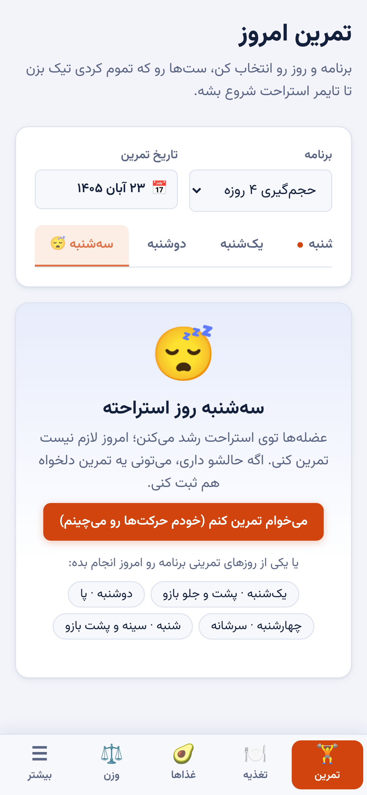<br>Rest day | 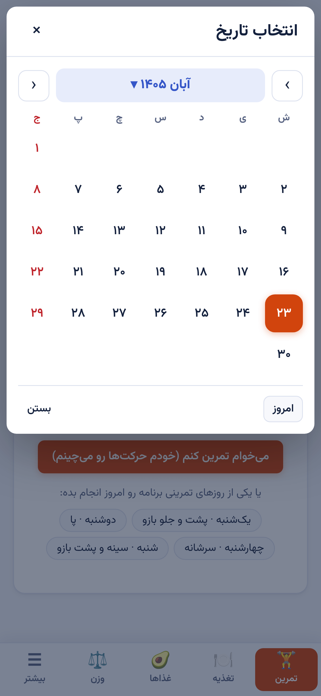<br>Jalali calendar | 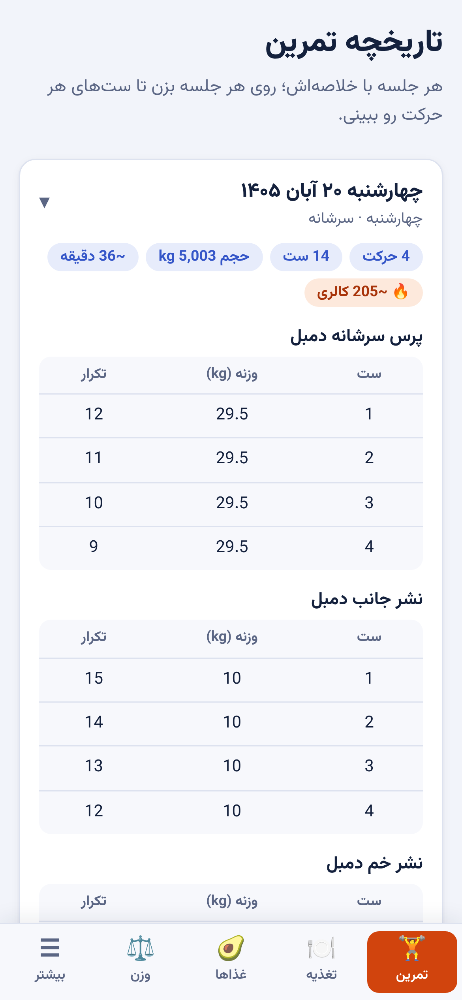<br>Workout history |
| 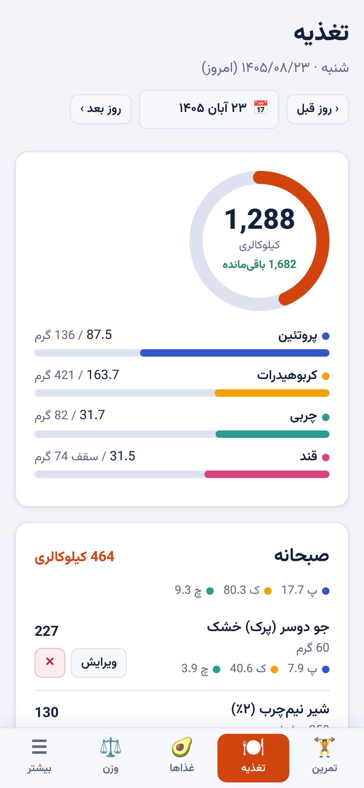<br>Daily nutrition | 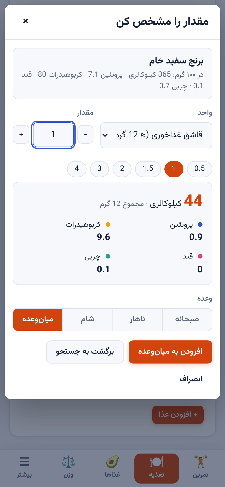<br>Add food with units | 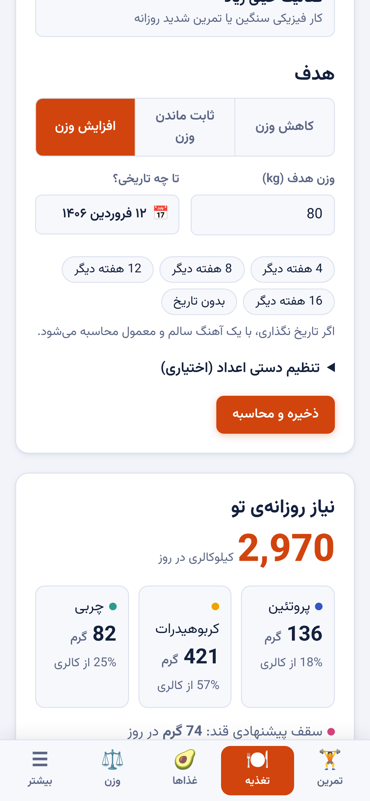<br>Calorie & macro plan |
| 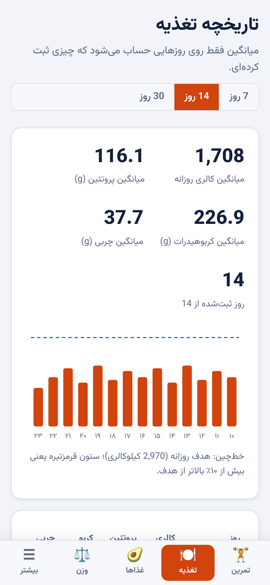<br>Nutrition history | 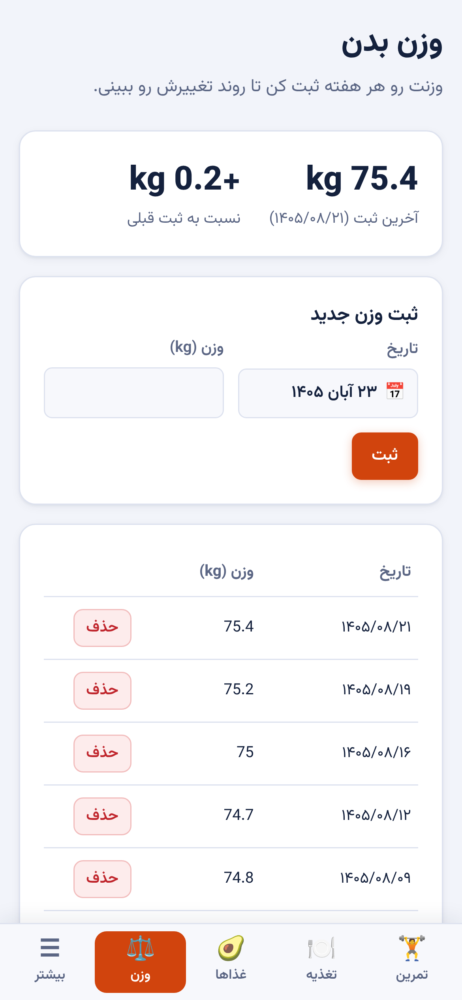<br>Body weight | 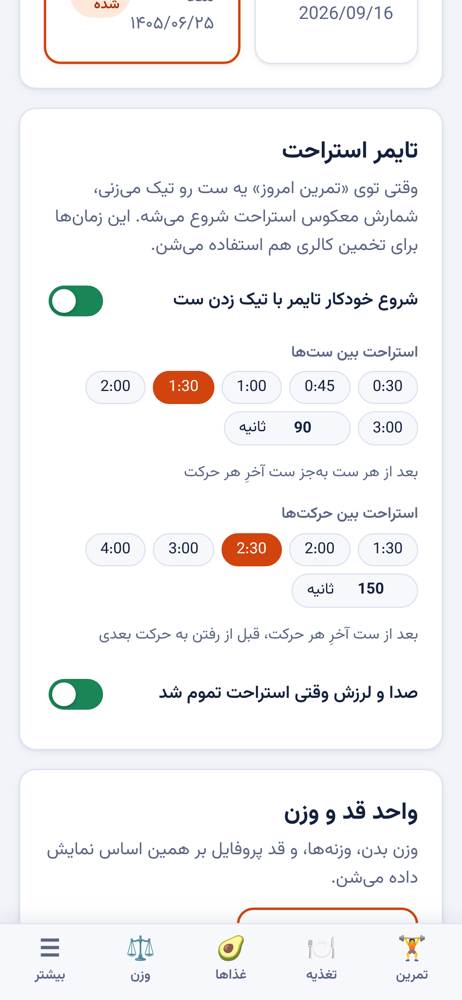<br>Settings |

### Tech
- **UI:** React 19, React Router 7, plain CSS (design tokens), Vazirmatn font, `jalaali-js`
- **Offline engine:** a small on-device JS backend (`src/local/`) — IndexedDB store, the same API surface as the original .NET backend, so the UI is identical in both
- **Mobile shell:** Capacitor 8 (Android), plugins: Filesystem, Share
- **Tooling:** Vite 8, oxlint

### Run it

```bash
npm install
npm run dev            # open the printed URL in a browser (use mobile view in DevTools)
```

Build the Android app (needs Android Studio):

```bash
npm install
npm run cap:sync       # builds the web app and copies it into android/
npm run cap:open       # opens the project in Android Studio → Build > Build APK(s)
```

### Try it with demo data
Import `demo/gymora-demo-backup.json` from **More → Settings → Backup → Restore from file** to see the app filled with 2 weeks of sample workouts, meals and body-weight entries.

### Project layout
```
src/
  pages/        screens (Train, History, Nutrition, Goals, Weight, Settings…)
  components/   RestTimer, DateField (Jalali calendar), modals…
  local/        offline backend: store (IndexedDB), engine, seed data
  utils/        dates (Jalali), calories (MET), nutrition helpers
android/        Capacitor Android project
demo/           sample backup file
docs/           screenshots
```

### License
MIT

---

## فارسی

**Gymora** یک اپ موبایل تک‌کاربره برای ثبت تمرین باشگاه و تغذیه روزانه‌ست. همه‌چیز **روی خود گوشی** اجرا می‌شه؛ نه سرور داره نه حساب کاربری. داده‌ها داخل IndexedDB گوشی ذخیره می‌شن و می‌شه ازشون فایل پشتیبان (JSON) گرفت و دوباره برگردوند.

### امکانات
- **ثبت تمرین** — انتخاب برنامه و روز، تیک زدن هر ست؛ وزنه و تکرار از جلسه‌ی قبل پر می‌شه.
- **تایمر استراحت** — زمان استراحت بین ست‌ها و بین حرکت‌ها از تنظیمات قابل تغییره؛ با صدا و ویبره.
- **ویرایش تمرین حین ورزش** — اضافه/جابه‌جایی/حذف/تعویض حرکت و اضافه یا کم کردن ست؛ تمرین نیمه‌کاره بعد از بستن اپ برمی‌گرده.
- **روز استراحت** — اپ می‌گه امروز استراحته و اگه خواستی می‌تونی تمرین آزاد یا یکی از روزهای برنامه رو انجام بدی.
- **تخمین کالری سوزانده‌شده** — با روش MET، از روی ست‌ها، زمان استراحت و وزن بدن.
- **تاریخچه تمرین** — جلسه‌ها با حجم، مدت، کالری و جدول ست‌ها.
- **تغذیه** — دیتابیس غذا با واحدهای خانگی (قاشق، عدد، لیوان…)، وعده‌ها، حلقه‌ی کالری و درشت‌مغذی‌ها، نمودار ۷/۱۴/۳۰ روزه.
- **برنامه‌ی کالری و درشت‌مغذی** — با فرمول Mifflin-St Jeor، سطح فعالیت و هدف وزنی با تاریخ.
- **ثبت وزن بدن**، **تقویم شمسی**، واحد کیلو/پوند، تاریخ شمسی یا میلادی.
- **پشتیبان‌گیری و بازیابی** با فایل JSON.

### اجرا
مثل بخش انگلیسی بالا: `npm install` و بعد `npm run dev` برای مرورگر، یا `npm run cap:sync` و `npm run cap:open` برای ساخت APK در اندروید استودیو.
برای دیدن اپ با داده‌ی نمونه، فایل `demo/gymora-demo-backup.json` رو از **بیشتر ← تنظیمات ← پشتیبان‌گیری ← بازیابی از فایل** وارد کن.
